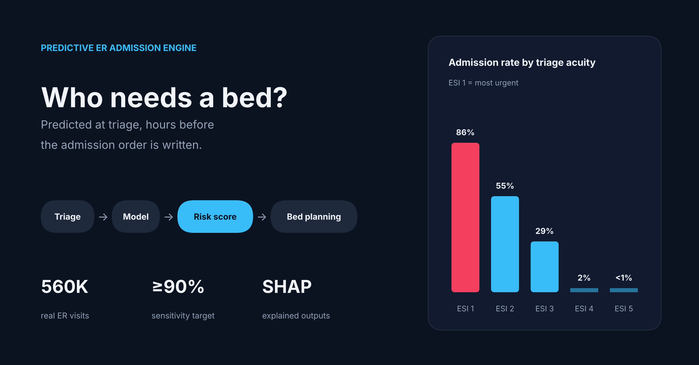
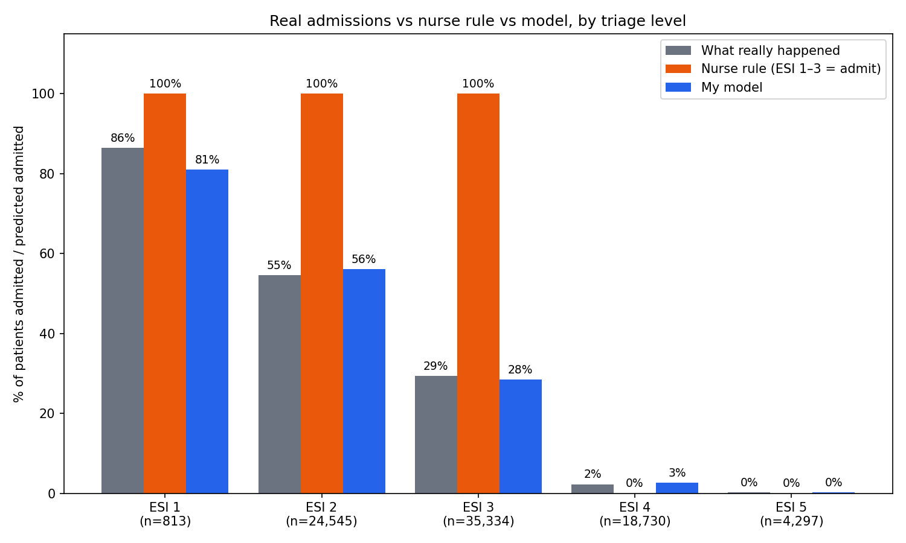
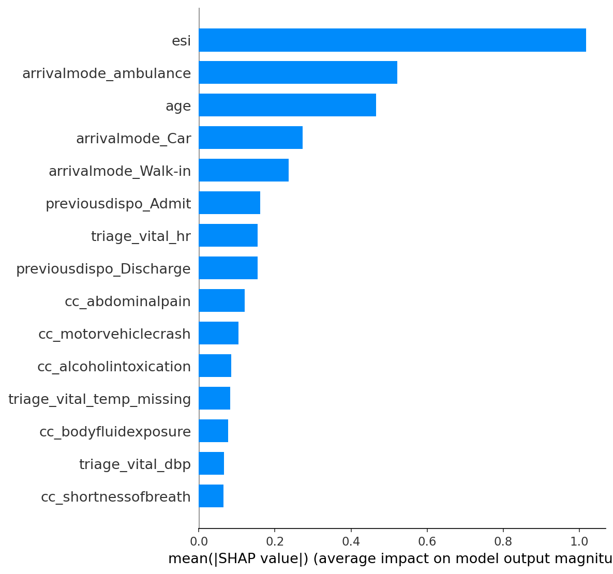
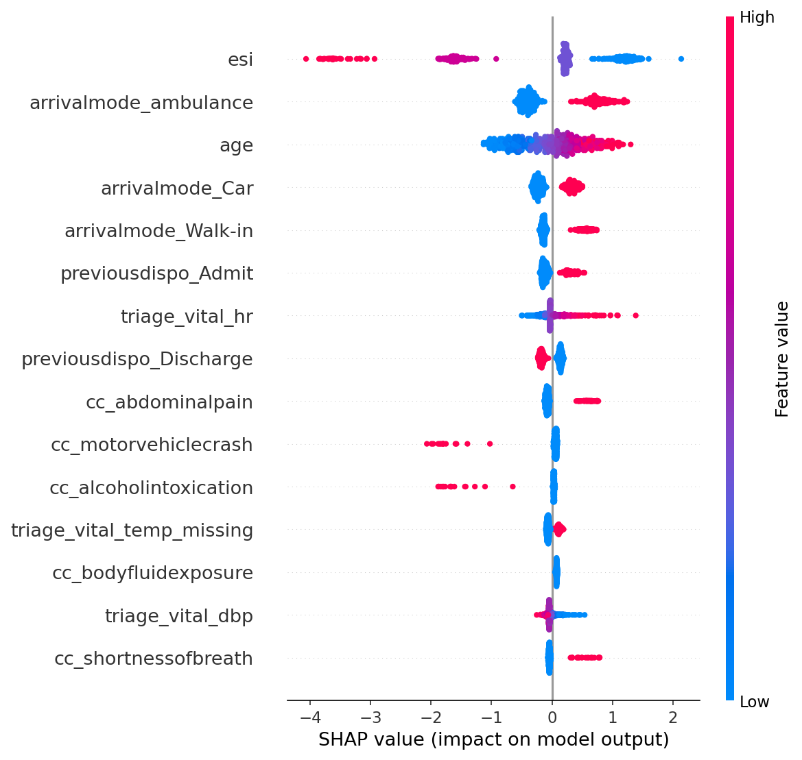
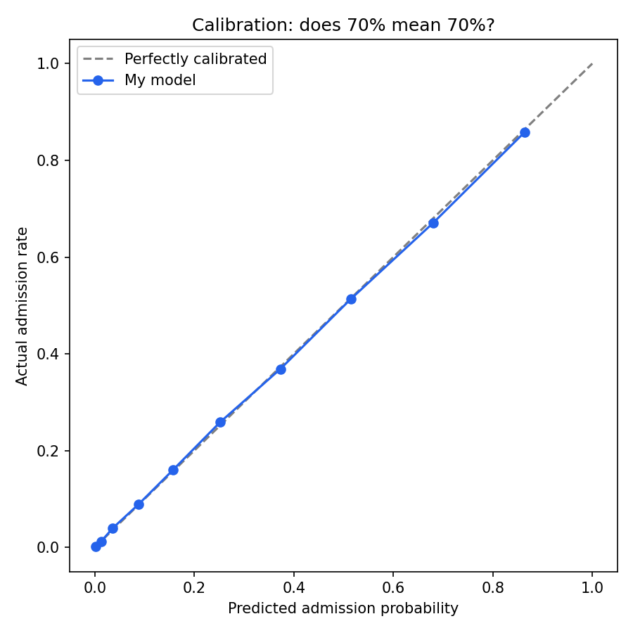

# Predictive ER Admission Engine

Machine learning model that predicts, **at the moment of triage**, whether an emergency department patient will need an inpatient bed, giving hospitals a head start on bed logistics hours before an admission order is written.

> ⚠️ Research and portfolio project. Not a medical device and not intended for clinical use.

## The problem

Canadian emergency departments face chronic bed shortages. Patients who need admission often wait hours on ER stretchers ("boarding") because bed searches only begin after a physician writes the admission order. Boarding blocks ER capacity and drives up wait times for everyone.

## The approach

The moment a triage nurse records vitals and acuity, the model outputs a probability that the patient will be admitted. Bed management teams can use high-risk flags to start sourcing beds early.

Design principles:
- **Triage-time features only.** Nothing recorded after triage (labs, imaging, physician notes), to avoid data leakage.
- **Sensitivity first.** The decision threshold is tuned for ≥90% recall, because missing a patient who needs a bed is costlier than preparing one that goes unused.
- **Beat the current practice.** The benchmark is the nurse's **ESI** triage score, which is what hospitals already use.
- **Explainable.** SHAP values show which triage features drive each prediction, and in which direction.

## Data

[Hospital Triage and Patient History Data](https://www.kaggle.com/datasets/maalona/hospital-triage-and-patient-history-data) (Kaggle): ~560,000 adult ED visits from a US health system, from Hong, Haimovich & Taylor (2018), *Predicting hospital admission at emergency department triage using machine learning*, PLOS ONE.

- ~30% of visits result in admission
- Acuity is recorded as **ESI** (Emergency Severity Index), a 5-level scale comparable to Canada's **CTAS**
- Data is **not** included in this repo. See notebook 01 to download it.
- Stratified 70 / 15 / 15 train / validation / test split. Cutoffs are chosen on validation; all reported scores are on the untouched test set.

## Results

| Model | Test AUROC |
|---|---|
| Nurse ESI score (as a risk score) | 0.765 |
| Logistic regression | 0.872 |
| **PyTorch neural network** | **0.878** |
| LightGBM | 0.880 |

For reference, the original study reported an AUROC of about 0.87.

**Model vs the nurse's ESI rule at the same recall.** The usual hospital rule is to treat ESI 1–3 as "likely admit". Matching that rule's recall (97.9%) on the test set:

| | Patients flagged | Recall | Precision | False alarms |
|---|---|---|---|---|
| Nurse rule (ESI ≤ 3) | 60,692 | 0.979 | 0.403 | 36,225 |
| PyTorch model | 57,522 | 0.979 | 0.425 | 33,063 |

At 90% recall the PyTorch model has a precision of 0.533, meaning about 53% of the patients it flags are really admitted.



### Key findings

- The model ranks admitted patients above non-admitted ones about 88% of the time, against about 76.5% for ESI alone.
- At the same 98% recall as the ESI ≤ 3 rule, the model raises about 3,200 fewer false alarms (~9% fewer). The gain at that very high recall is modest.
- ESI is a coarse 5-level scale (ESI ≤ 2 catches ~57% of admits, ESI ≤ 3 catches ~98%, with nothing in between). The model gives a continuous risk score, so a hospital can pick any recall target.
- A small neural network, logistic regression and LightGBM all land within 0.01 AUROC of each other. With triage-only data, the ceiling comes from the information available, not the algorithm.

## What drives the predictions (SHAP)

SHAP breaks each prediction into per-feature pushes: how far each feature moved that patient's risk above or below the average patient's.





Computed for the PyTorch model on 500 test patients. In the beeswarm, each dot is a patient, right means pushed toward admission, and red means a high value (for yes/no features, red means yes).

- **ESI is the dominant signal**, about twice as strong as anything else. A high ESI number (less urgent) pushes risk down hard, and an urgent one pushes it up.
- **Arrival mode** is next. Arriving by ambulance pushes risk up.
- **Age:** older patients get higher risk, in a smooth gradient.
- **Vitals:** a high heart rate, low diastolic blood pressure and being on an oxygen device all push risk up.
- **Prior visit:** a previous admission raises risk, and a previous discharge lowers it.
- **Chief complaint:** abdominal pain pushes risk up, while motor vehicle crash and alcohol intoxication push it down strongly, since many of these patients are treated and sent home.

The model relies on clinically sensible, triage-time signals and not on anything suspicious. SHAP describes what the model learned from this dataset (associations), not causes.

## Calibration

A model's probabilities are only useful if they are honest: when it says 70%, about 70% of those patients should really be admitted.



Test patients were split into 10 equal-sized groups by predicted risk:

| Predicted risk | Actual admission rate |
|---|---|
| 0.2% | 0.2% |
| 1.2% | 1.2% |
| 3.6% | 4.0% |
| 8.8% | 8.8% |
| 15.8% | 16.0% |
| 25.2% | 25.9% |
| 37.3% | 36.9% |
| 51.4% | 51.3% |
| 68.1% | 67.1% |
| 86.4% | 85.9% |

The model is **well calibrated** across the whole range: predicted and actual rates agree to within about one percentage point, so its scores can be read as real probabilities. The Brier score is 0.127 (lower is better; always predicting the average admission rate scores about 0.21).

## Repo structure

```
notebooks/
  01_data_loading.ipynb    Kaggle download, triage feature extraction, cache to Drive
  02_eda.ipynb             Admission rate by acuity, vitals, missingness
  03_baselines.ipynb       ESI-only vs logistic regression vs LightGBM
  04_pytorch_model.ipynb   PyTorch neural network, comparison against the nurse's ESI, SHAP, calibration
images/                    Figures for this README
```

## How to run

1. Open `notebooks/01_data_loading.ipynb` in Google Colab.
2. Add your Kaggle credentials to Colab Secrets (🔑 in the sidebar).
3. Run notebooks 01 → 04 in order. Data is cached to your Google Drive after notebook 01.

## Roadmap

- [x] Data pipeline
- [x] Exploratory analysis
- [x] Baseline models (ESI, logistic regression, LightGBM)
- [x] PyTorch model compared against the nurse's ESI
- [x] SHAP explainability
- [x] Calibration analysis

## Limitations

- Trained on US data with ESI acuity; Canadian deployment would require validation on CTAS-coded data.
- Single health system, which may not generalize to other hospitals.
- No visit timestamps, so evaluation uses a random rather than time-based split.
- SHAP explanations are computed on a 500-patient sample and show associations the model learned, not causal effects.
- The ESI-based baseline comes from the same dataset's historical admit rates, not from a clinician's explicit admission prediction.

## Author

Chizaram Agbanelo
